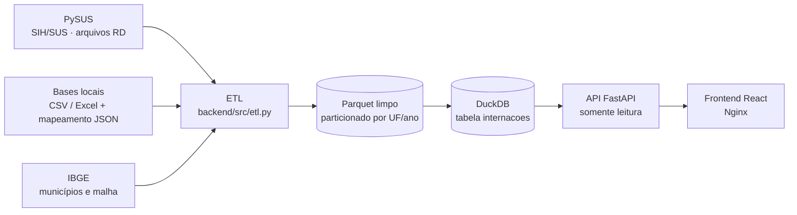

# Dashboard SUS — Monitoramento Epidemiológico

Dashboard interativo de saúde pública construído sobre dados abertos do **SUS (DATASUS / Ministério da Saúde)**. Parte das internações hospitalares do **SIH/SUS** e permite acompanhar agravos por capítulo da CID-10, território, período e perfil demográfico, com um município em foco (por padrão, **Patos/PB**) e suporte para anexar uma base local da cidade.

O foco inicial são as **doenças do aparelho circulatório (CID-10 cap. IX)** e **respiratório (cap. X)**, mas a arquitetura é extensível a qualquer outro grupo de agravos.

---

## Sumário

- [Funcionalidades](#funcionalidades)
- [Arquitetura](#arquitetura)
- [Início rápido](#início-rápido)
- [Configuração](#configuração)
- [Base local (Patos/PB)](#base-local-patospb)
- [API](#api)
- [Desenvolvimento sem Docker](#desenvolvimento-sem-docker)
- [Testes](#testes)
- [Estrutura do repositório](#estrutura-do-repositório)
- [Fonte e limitações dos dados](#fonte-e-limitações-dos-dados)
- [Privacidade e LGPD](#privacidade-e-lgpd)
- [Decisões de projeto](#decisões-de-projeto)
- [Roadmap](#roadmap)

---

## Funcionalidades

**Filtros combináveis**

- Grupo de doenças (capítulos da CID-10) e busca por subcategoria, por código ou nome (ex.: `I21`, "pneumonia").
- UF, município (código IBGE) e período por data de internação.
- Faixa etária, sexo, caráter do atendimento e complexidade.
- Fonte dos dados (SIH/SUS ou bases locais) e referência do município: **residência do paciente** ou **local do atendimento**.

**Indicadores e visualizações**

- **Indicadores principais** com variação em relação ao período anterior (mês a mês) ou ao mesmo período do ano anterior: internações, mortalidade hospitalar, permanência média e custo.
- **Série temporal** mensal por capítulo.
- **Pirâmide etária** por sexo.
- **Top 10 agravos** (CID-10, 3 caracteres), com o nome da doença.
- **Mapa coroplético** dos municípios da UF, clicável, com troca de métrica (internações, óbitos, letalidade) e município em foco destacado.
- **Tabela de municípios** ordenável, com busca e paginação.
- **Exportação em CSV** dos dados filtrados.

**Robustez**

- ETL idempotente: meses já processados são reaproveitados do cache.
- Linhas inválidas são separadas em `rejeitados`, nunca derrubam a carga.
- A falha de uma fonte local não impede o carregamento do SIH.
- Filtros validados na API; a API responde `503` com orientação clara se o banco ainda não existe.
- Consultas SQL parametrizadas.

---

## Arquitetura



| Camada        | Tecnologia                           | Papel                                                       |
| ------------- | ------------------------------------ | ----------------------------------------------------------- |
| Coleta        | PySUS 2.12.2                         | Baixa os arquivos do SIH (RD)                               |
| Tratamento    | pandas / ETL próprio                 | Limpeza, validação de CID, datas, idade, sexo, município    |
| Armazenamento | Parquet + DuckDB                     | Cache local e consultas analíticas rápidas                  |
| API           | FastAPI + Pydantic                   | Endpoints de agregação, filtros validados, CSV em streaming |
| Interface     | React + Vite + TypeScript + Recharts | Painel interativo; mapa em SVG, sem serviço externo         |
| Execução      | Docker Compose + Nginx               | Três serviços: `etl` → `backend` → `frontend`               |

O DuckDB aceita um único escritor: o **ETL grava**, a **API só lê** (`read_only`).

---

## Início rápido

Requisitos: **Docker** e **Docker Compose** em execução.

```bash
git clone <https://github.com/joaokleber10/Dashboard-SUS.git>
cd Dashboard-SUS
cp .env.example .env
docker compose up --build
```

Quando terminar:

| Serviço                        | Endereço                   |
| ------------------------------ | -------------------------- |
| Dashboard                      | http://localhost:5173      |
| API                            | http://localhost:8000      |
| Documentação interativa da API | http://localhost:8000/docs |

Na primeira execução o ETL baixa os dados do SIH e a malha do IBGE, o que exige internet e pode levar alguns minutos. Nas seguintes, os meses já processados são pulados. No Windows, use `copy .env.example .env` no lugar de `cp`.

---

## Configuração

Todas as variáveis ficam no arquivo `.env` (modelo em `.env.example`).

| Variável                          | Padrão                  | Descrição                                                     |
| --------------------------------- | ----------------------- | ------------------------------------------------------------- |
| `ETL_UF`                          | `PB`                    | UF (ou lista separada por vírgula) a carregar                 |
| `ETL_YEAR_START` / `ETL_YEAR_END` | `2023` / `2024`         | Intervalo de anos                                             |
| `ETL_SOURCE`                      | `SIH`                   | Fonte oficial (hoje apenas SIH)                               |
| `FOCO_UF` / `FOCO_MUNICIPIO`      | `PB` / `Patos`          | Município em foco: nome ou código IBGE. Vazio desativa o foco |
| `FONTES_DIR`                      | `refs/fontes`           | Pasta com os JSON de bases locais                             |
| `CID10_PATH`                      | `refs/cid10.csv`        | CSV opcional com o nome exato de cada categoria da CID-10     |
| `DATA_DIR` / `DUCKDB_PATH`        | `/app/data`             | Onde ficam o cache e o banco                                  |
| `PYSUS_CACHEPATH`                 | `/app/data/pysus_cache` | Cache de downloads do PySUS                                   |
| `BACKEND_PORT` / `FRONTEND_PORT`  | `8000` / `5173`         | Portas publicadas                                             |
| `CORS_ORIGINS`                    | `http://localhost:5173` | Origens aceitas pela API (separadas por vírgula)              |
| `VITE_API_URL`                    | `http://localhost:8000` | URL da API **vista pelo navegador**; é embutida no build      |
| `EXPORT_MAX_ROWS`                 | `500000`                | Limite de linhas do CSV exportado                             |
| `PYTHON_VERSION` / `NODE_VERSION` | `3.12` / `20`           | Versões das imagens                                           |

> Alterou `VITE_API_URL`? Rode `docker compose up --build` para refazer o frontend.

**Nomes de CID-10.** Por padrão, cada código mostra o nome do **bloco** a que pertence (`backend/src/cid10_blocos.py`), por exemplo _I21 · Doenças isquêmicas do coração (bloco I20-I25)_. Para o nome exato de cada categoria, coloque um CSV com as colunas `CAT` e `DESCRICAO` em `backend/refs/cid10.csv`; as categorias presentes nele passam na frente.

---

## Base local (Patos/PB)

O sistema aceita bases locais em **CSV ou Excel** que se somam ao SIH. Cada base é descrita por um arquivo JSON que diz qual coluna do seu arquivo corresponde a cada campo do dashboard, sem alterar código.

1. Coloque o arquivo em `backend/dados-locais/` (sem nome, CPF, CNS, endereço ou telefone).
2. Copie `backend/refs/fontes/patos.exemplo.json` para `patos.json` e ajuste os nomes das colunas.
3. Confira o mapeamento sem gravar nada:
   ```bash
   python -m src.etl --inspect-fonte refs/fontes/patos.json
   ```
4. Rode o ETL de novo (`docker compose up --build`). A nova fonte aparece no filtro **Fonte dos dados**.

Campos mapeáveis: data de internação (obrigatório), CID (obrigatório), data de saída, data de nascimento, idade, sexo, município de residência e de atendimento, dias de permanência, valor, óbito, caráter, complexidade e especialidade. Valores de texto (por exemplo "ÓBITO", "Masculino") são traduzidos por tabelas no próprio JSON. Detalhes em `backend/refs/fontes/LEIA-ME.txt`.

> **Atenção à dupla contagem.** Se os hospitais da base local já faturam no SIH, as mesmas internações aparecem nas duas fontes. Use o filtro de fonte para analisá-las separadamente.

---

## API

Documentação interativa em `/docs`. Todos os endpoints de dados aceitam os mesmos filtros.

| Endpoint               | Descrição                                                          |
| ---------------------- | ------------------------------------------------------------------ |
| `GET /health`          | Estado do serviço e do banco                                       |
| `GET /meta/filtros`    | Opções dos filtros, período disponível, município em foco e fontes |
| `GET /kpis`            | Indicadores com variação                                           |
| `GET /serie-temporal`  | Evolução mensal (por capítulo ou total)                            |
| `GET /demografia`      | Distribuição por faixa etária e sexo                               |
| `GET /top-cid`         | Agravos mais frequentes                                            |
| `GET /cid/buscar`      | Busca de subcategorias por código ou nome                          |
| `GET /municipios`      | Tabela de municípios (ordenação, busca, paginação)                 |
| `GET /municipios/mapa` | Todos os municípios do recorte, para o mapa                        |
| `GET /geojson`         | Malha municipal da UF                                              |
| `GET /export.csv`      | Dados filtrados em CSV (streaming, limitado por `EXPORT_MAX_ROWS`) |

**Parâmetros de filtro:** `capitulo_ids`, `grupo_ids`, `cid_codigos`, `uf`, `municipio`, `data_inicio`, `data_fim`, `faixas_etarias`, `sexos`, `carater`, `complexidade`, `fontes`, `municipio_ref` (`residencia` ou `atendimento`) e `comparacao` (`periodo_anterior` ou `ano_anterior`).

```bash
curl "http://localhost:8000/kpis?capitulo_ids=IX&capitulo_ids=X&uf=PB&data_inicio=2023-01-01&data_fim=2023-12-31"
```

---

## Desenvolvimento sem Docker

Requisitos: Python 3.10+ e Node 20+.

```bash
# Backend
python -m venv .venv
.venv\Scripts\activate            # Linux/macOS: source .venv/bin/activate
cd backend
pip install -r requirements.txt
python -m src.etl                 # carga (ver opções abaixo)
python -m uvicorn src.app:app --reload --port 8000

# Frontend (em outro terminal)
cd frontend
npm install
npm run dev                       # http://localhost:5173
```

Opções do ETL:

```bash
python -m src.etl --uf PB,PE --start 2023 --end 2024   # recorte
python -m src.etl --force            # reprocessa mesmo o que está em cache
python -m src.etl --inspect          # baixa 1 mês e mostra colunas/valores
python -m src.etl --skip-fontes      # não processa bases locais
python -m src.etl --skip-geo         # não baixa nomes/malha do IBGE
python -m src.etl --refresh-geo      # baixa de novo nomes e malha
```

Fora do Docker, o ETL e a API leem `DATA_DIR`/`DUCKDB_PATH` relativos à pasta em que são executados.

---

## Testes

```bash
cd backend
python -m pytest -q
```

A suíte cobre o dicionário de domínio, a limpeza do ETL, as consultas SQL, a exportação CSV, o catálogo de CID, o adaptador de fontes locais e a API de ponta a ponta (com um DuckDB temporário).

---

## Estrutura do repositório

```
Dashboard-SUS/
├── docker-compose.yml
├── .env.example
├── backend/
│   ├── Dockerfile.backend
│   ├── requirements.txt
│   ├── src/
│   │   ├── app.py           # API FastAPI
│   │   ├── etl.py           # coleta, limpeza e carga (SIH + fontes locais)
│   │   ├── fontes.py        # adaptador de bases locais (CSV/Excel + JSON)
│   │   ├── geo.py           # municípios e malha do IBGE, com cache
│   │   ├── catalogos.py     # nomes de CID-10 (blocos + CSV opcional)
│   │   ├── cid10_blocos.py  # blocos oficiais da CID-10
│   │   ├── dictionary.py    # capítulos, grupos, UFs, faixas etárias e códigos
│   │   ├── queries.py       # consultas e filtros SQL parametrizados
│   │   ├── schemas.py       # validação dos filtros
│   │   ├── export.py        # CSV em streaming
│   │   └── db.py            # conexão DuckDB (somente leitura)
│   ├── tests/
│   ├── refs/                # fontes/*.json, LEIA-ME e cid10.csv opcional
│   └── dados-locais/        # arquivos das bases locais (fora do Git)
└── frontend/
    ├── Dockerfile.frontend
    └── src/                 # componentes React, tipos e cliente da API
```

---

## Fonte e limitações dos dados

**Fonte efetivamente utilizada:** **SIH/SUS** (Sistema de Informações Hospitalares), arquivos de AIH reduzida (RD), obtidos pelo PySUS a partir dos dados abertos do DATASUS. Opcionalmente, bases locais mapeadas por JSON.

Leia os resultados com estas ressalvas:

- **Apenas o SUS.** Internações da saúde suplementar e atendimentos ambulatoriais não estão incluídos; não representa toda a morbidade da população.
- **A unidade é a internação (AIH), não o paciente.** A mesma pessoa pode aparecer mais de uma vez.
- **Diagnóstico principal não é causa da morte.** "Óbito" significa óbito hospitalar durante a internação, não mortalidade geral por causa.
- **Defasagem de processamento.** Os meses mais recentes costumam estar incompletos, o que pode parecer uma queda artificial.
- **Residência × atendimento.** O mapa, por padrão, usa o município de residência do paciente. Os dois recortes respondem a perguntas diferentes (demanda da população × oferta de serviços).
- **Dependência do espelho do PySUS.** Se a fonte estiver fora do ar, o ETL registra a falha e mantém o que já está em cache.
- **Nomes de CID por bloco.** Sem `cid10.csv`, o nome mostrado é o do grupo, não o da doença individual.
- **Dados do SIH são administrativos e de faturamento**, sujeitos a erros de registro (por exemplo, município ou CID ausentes). Esses casos aparecem como "não identificado" e entram nos relatórios do ETL.

---

## Privacidade e LGPD

- O SIH disponibilizado publicamente é **anonimizado**; o dashboard não exibe identificadores de pacientes, e a exportação CSV não inclui o número da AIH.
- O adaptador de bases locais **recusa** colunas de identificação mapeadas como `id` (nome, CPF, CNS, endereço, telefone, prontuário) e descarta da memória todas as colunas não mapeadas.
- A pasta `backend/dados-locais/` está no `.gitignore`: **nunca versione dados de pacientes**.
- Células com poucos casos em municípios pequenos podem permitir reidentificação; ao divulgar resultados, avalie agregar por período ou território.

---

## Decisões de projeto

- **Vite + React em vez de Next.js:** o painel é uma aplicação de página única que consome uma API própria; não precisa de renderização no servidor.
- **DuckDB + Parquet:** análises agregadas rápidas sobre centenas de milhares de linhas, sem servidor de banco; o cache particionado evita baixar de novo.
- **API somente leitura:** um único escritor (o ETL) elimina conflitos de bloqueio no DuckDB.
- **Dicionário como fonte única de verdade** (`dictionary.py`): ETL, API e frontend (via `/meta/filtros`) dependem dele; incluir um novo grupo de agravos não exige mudar as consultas.
- **Mapa em SVG próprio:** sem dependência de serviços de mapas externos nem de chaves de API.
- **Volume nomeado no Docker** para os dados: evita problemas de permissão e de bloqueio de arquivo em pastas sincronizadas (como OneDrive) ou montadas do Windows.

---

## Roadmap

- [ ] Carregar a base de Patos com o mapeamento real (`refs/fontes/patos.json`).
- [ ] Integrar o **SIM** (mortalidade por causa básica) para comparar internação e óbito.
- [ ] Taxas por 100 mil habitantes, com população do IBGE.
- [ ] Mais UFs e anos no recorte padrão.
- [ ] Testes automatizados do frontend e pipeline de integração contínua.

---
